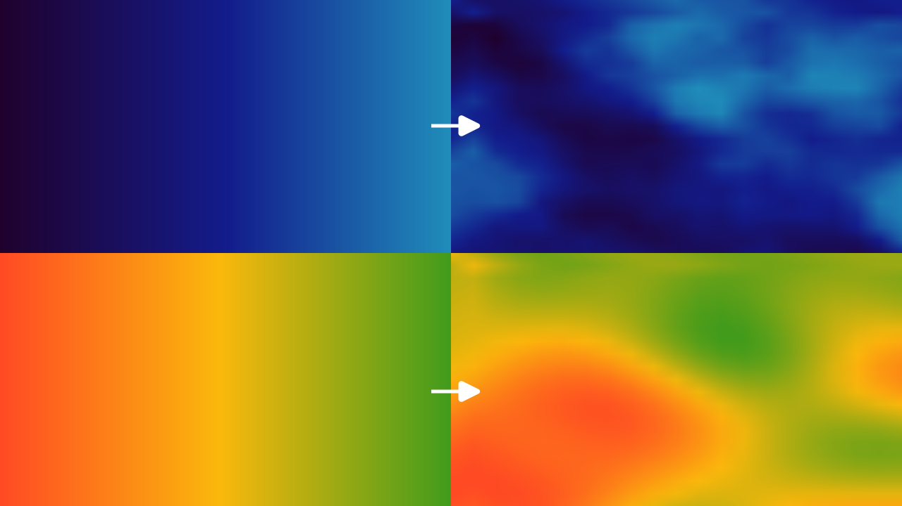

# Inkscape Noise Mesh Gradient

Turn your gradient-filled objects into soft, cloud-like mesh gradients. Fill shapes with organic color blends for backgrounds, abstract illustrations, or poster art.

## Features

- Converts a gradient-filled object into a **mesh gradient** with configurable rows × columns
- Noise value at every mesh node drives the color sampled from the **original gradient stops** (offsets, colors, and opacity all preserved)
- Configurable noise type: **Simplex**, **fBm** (fractal Brownian motion), or **Turbulence**
- Adjustable fractal parameters (octaves, lacunarity, gain) for fBm and Turbulence
- Reproducible results via a fixed noise seed
- Auto-normalized noise → gradient mapping so the full color range is always used
- Preserves stop opacity (including per-stop `stop-opacity`)

## Install

Copy both files into your Inkscape extensions folder:

- **Linux:** `~/.config/inkscape/extensions/`
- **Windows:** `%APPDATA%\inkscape\extensions\`
- **macOS:** `~/Library/Application Support/org.inkscape.Inkscape/config/inkscape/extensions/`

Restart Inkscape.

Requires Inkscape 1.x (Python 3 + `inkex`).

## Usage

1. Select one or more objects **with a gradient fill**.
2. Go to **Extensions → Render → Noise Mesh Gradient**.
3. Adjust parameters and click **Apply**.

> **Tip:** The plugin reads the stops of the object's existing gradient fill and uses them as the color palette for the mesh. A multi-stop gradient (e.g. teal → cream → coral) gives the richest results. Objects without a gradient fill are skipped with an error message.

## Parameters

| Param | Description |
|---|---|
| Rows | Number of mesh patches vertically (grid is `(rows+1) × (cols+1)` nodes) |
| Columns | Number of mesh patches horizontally |
| Noise Scale | Smaller = smoother/larger color blobs; larger = busier variation |
| Noise Type | Noise algorithm: `simplex` (single-octave), `fbm` (fractal sum), or `turbulence` (absolute-value fractal sum) |
| Octaves | Number of noise layers summed (fBm / Turbulence only) |
| Lacunarity | Frequency multiplier between octaves (fBm / Turbulence only) |
| Gain | Amplitude multiplier between octaves (fBm / Turbulence only) |
| Noise Seed | the same value reproduces the same pattern |

## License

MIT